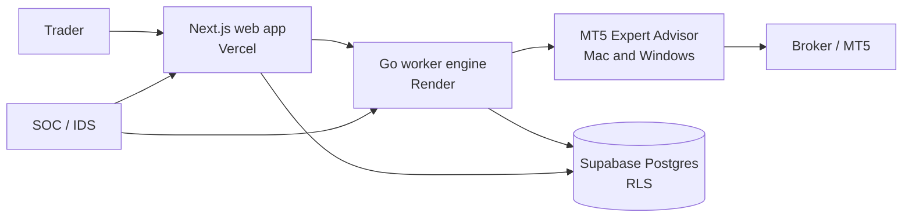

# Watchtower Quant Brain

MetaTrader 5 gives you a terminal and an Expert Advisor. What it does not give you is a brain in front of that EA. You set a watchlist, then spend the session guessing which pair deserves attention while indicators disagree and risk rules live only in your head. That is the gap.

Watchtower Quant Brain is the supervised cockpit for that job: a command centre that ranks the markets you care about, gates signals before anything reaches the broker, and puts an MT5 Expert Advisor on Mac and Windows as the hands that execute what you clear. You set the watchlist and the policy. The dashboard shows rank, signal context, and system status. The EA is how a cleared signal reaches MetaTrader 5. It is not a broker, an investment adviser, or a substitute for your judgment.

Market losses and conditions are not controlled by us, but the strategies are tested and trusted by traders all around the world and used daily by them.

## Live demo

- App: [https://watch-five-lovat.vercel.app](https://watch-five-lovat.vercel.app)
- Narrated walkthrough: [https://streamable.com/2rt97r](https://streamable.com/2rt97r)

## MT5 Expert Advisor (core sell)

The MetaTrader 5 bridge is not optional. Customers run the Expert Advisor in their own terminal or VPS on **Mac and Windows**. The Go engine ranks and gates; the EA is the execution path to the broker. Auto-trade stays off until the trader turns it on. Paper mode lets you rehearse without live orders.

## SOC / IDS

Watchtower ships with an in-house security operations layer: login and attack-event logging, detection rules, alert routing, and an access-controlled review console. It is built to watch the product itself (auth abuse, injection attempts, suspicious sessions), not as a general market-data feed.

## Architecture

More detail: [docs/architecture.md](docs/architecture.md).

## Screenshots

Omni-Scanner ranking public research candidates across the configured universe:

AI-confirmed delivery queue (broker delivery needs fresh broker evidence):

## Tech stack

| Layer | Choice |
| --- | --- |
| Web | Next.js / TypeScript on Vercel |
| Engine | Go worker on Render |
| Data | Supabase Postgres with row-level security |
| Execution | MetaTrader 5 Expert Advisor (Mac and Windows) |
| Security | In-house SOC / IDS, account hardening, AI prompt guards |

## This repository

This is a **public showcase**: README, architecture notes, and screenshots only. It is not the product source tree. The private application repository stays private. No API keys, PINs, environment files, strategy source, or EA source are published here.

## Disclaimer

Software and signals can fail. Market data may be delayed, incomplete, or wrong. Past behaviour is not a promise of future results. You trade with your own capital and your own judgment.
